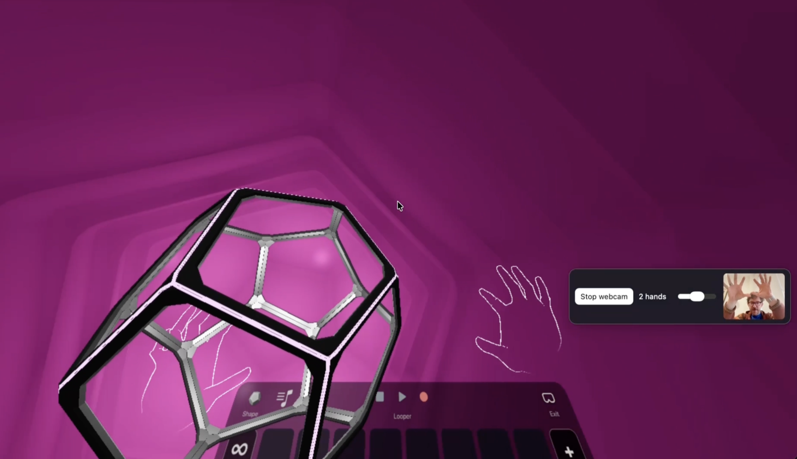

# WebXR webcam hands



*Live webcam tracking in Playtonik: the camera preview shows two hands, while articulated WebXR hands appear around the orb.*

A desktop development tool that turns webcam hand tracking into articulated
WebXR input sources. It adapts the hand mapping from
[mrdoob's WebXR Webcam Emulator](https://github.com/mrdoob/webxr-webcam-emulator)
and feeds joints through [Meta's IWER](https://github.com/meta-quest/immersive-web-emulator).
The app receives ordinary `XRInputSource.hand` data. No A-Frame or Threlte is
required.

**[Try the browser demo](https://5of12.co.uk/webxr-webcam-hands/)** — allow camera access, enter VR, and move your hands around the target. It runs over HTTPS and processes camera frames in your browser.

Its first integration is
[Playtonik](https://playtonik.cc/), built with IWSDK and Three.js. The first
live-hand check worked well, and automated tests exercise the WebXR path with
synthetic joints. Broader camera and browser coverage is still to come.

## Try the demo

Open the [hosted demo](https://5of12.co.uk/webxr-webcam-hands/), or run it locally with Node 20.19+, 22.12+, or 24+ and a desktop browser with a webcam:

```sh
npm ci
npm run dev
```

Open `http://127.0.0.1:5174/`. Click **Start webcam**, allow camera access,
then **Enter VR**. The demo draws each tracked WebXR joint around a simple
target. **Stop webcam** releases the camera. Moving a hand toward the webcam
pushes its virtual hand toward the scene. The **Distance** slider shifts the
virtual hands toward or away from the scene for different camera setups.
Closing your thumb and index finger shows a small ring at the pinch point;
the demo uses Playtonik’s 2 cm pinch-on and 3.5 cm pinch-off thresholds. It
does not play Playtonik’s notes or implement its orb targeting. Video stays
in the browser.

The demo is deliberately small: it shows the input source, not a complete XR
room. Playtonik adds its own keyboard, orb, pinch cues, and interactions.

Run `npm run check`, `npm test`, `npm run test:browser`, and `npm run build`
to verify the source and the synthetic WebXR hand path.

## Use in an IWSDK app

Install the tagged source from GitHub (or pin a specific commit for a locked build):

```sh
npm install --save-dev 'git+https://github.com/5of12/webxr-webcam-hands.git#v0.1.2'
```

Import `installWebcamXR()` before `World.create`. Use a separate desktop development mode that does not inject
another IWER runtime. See [the IWSDK setup example](docs/iwsdk.md). Native
Quest and normal emulator paths can stay as they are.

The source is in `src/`. `WebcamXRDevice.setHands()` also accepts synthetic
25-joint frames, which allows repeatable interaction tests without a camera.
The MediaPipe runtime and model URLs are pinned in `src/camera.ts`.

## Limits

A single webcam estimates distance from apparent palm size. It cannot measure
absolute depth or locate a real table, so it is best for VR hand interactions
and development checks, not reliable AR placement. Occlusion and poor light can
drop tracking. The current IWER 2.5.0 adapter writes joint poses through
exported internal symbols because IWER has no public streaming-joint setter;
that seam is version-sensitive.

## Credit and license

The landmark mapping and webcam approach were adapted from
[mrdoob/webxr-webcam-emulator](https://github.com/mrdoob/webxr-webcam-emulator)
(MIT, Copyright © 2025 Mr.doob). This repository retains that notice in its
[MIT license](LICENSE). IWER and MediaPipe are dependencies, not copied source;
their licenses and notices come with their packages.
